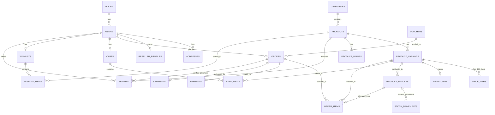

# KRAVO — Database ERD & Data Dictionary (Tahap 3)

**Nama Database**: `kravo_ecommerce`  
**RDBMS Engine**: MySQL 8.0 (InnoDB)  
**Dokumen Versi**: 1.0.0  
**Tanggal**: 2026-11-21  

---

## 1. ENTITY RELATIONSHIP DIAGRAM (ERD)

---

## 2. SPESIFIKASI 22 TABEL & DATA DICTIONARY

### 2.1 Modul Pengguna & Hak Akses
1. `roles`: Master peran sistem (`admin`, `reseller`, `customer`).
2. `users`: Akun pengguna multi-role, password hash Bcrypt/Argon2id.
3. `addresses`: Buku alamat pengiriman (jalan, kelurahan, kota, provinsi, kode pos, flag utama).
4. `reseller_profiles`: Informasi legalitas entitas bisnis B2B (NIB/NPWP, jenis usaha, status verifikasi `pending`/`approved`/`rejected`, path dokumen).

### 2.2 Modul Katalog & Varian Makanan
5. `categories`: Kategori snack (Potato Chips, Cassava, Cookies, Crackers, Spicy, Bundles).
6. `products`: Master produk (nama, deskripsi, komposisi alergen, petunjuk simpan).
7. `product_variants`: Varian produk (SKU, nama varian, gramasi berat, harga retail `DECIMAL(12,2)`).
8. `product_images`: Galeri foto resolusi tinggi produk kemasan.
9. `price_tiers`: Matrix harga grosir bertingkat B2B (`min_quantity`, `unit_price`, diskon %).

### 2.3 Modul Inventaris & Keamanan Pangan (Food Safety FEFO)
10. `inventories`: Agregasi stok fisik, stok terpesan (*reserved*), dan stok siap jual (*available*).
11. `product_batches`: Pelacakan batch produksi (Nomor Batch unik, Tanggal Manufaktur, Tanggal Kedaluwarsa, status FEFO `active`, `near_expiry`, `quarantined`).
12. `stock_movements`: Audit trail mutasi fisik setiap batch (`stock_in`, `allocated`, `dispatched`, `adjustment`, `expired_writeoff`).

### 2.4 Modul Keranjang & Wishlist
13. `carts`: Keranjang belanja pengguna (terikat `user_id` atau `session_id`).
14. `cart_items`: Item varian dan kuantitas dalam keranjang.
15. `wishlists`: Koleksi produk favorit pengguna.
16. `wishlist_items`: Item produk dalam wishlist.

### 2.5 Modul Transaksi & Pembayaran Midtrans
17. `orders`: Dokumen transaksi induk (Nomor Order unik, segmen `b2c_retail` vs `b2b_wholesale`, subtotal, diskon voucher, ongkir, grand total `DECIMAL(12,2)`, status).
18. `order_items`: Snapshot harga dan detail varian saat transaksi dibekukan (Anti-tampering).
19. `payments`: Riwayat pembayaran Midtrans Snap (token Snap, signature SHA-512, status `settlement`/`pending`/`cancel`).
20. `shipments`: Logistik pengiriman makanan (kurir JNE/SiCepat/Kargo, nomor resi, timeline dispatch).

### 2.6 Modul Promosi & Ulasan
21. `vouchers`: Kupon diskon dengan batasan kuota, minimal belanja, dan masa berlaku.
22. `reviews`: Ulasan dan rating 1–5 bintang dari pembeli pesanan terverifikasi.
