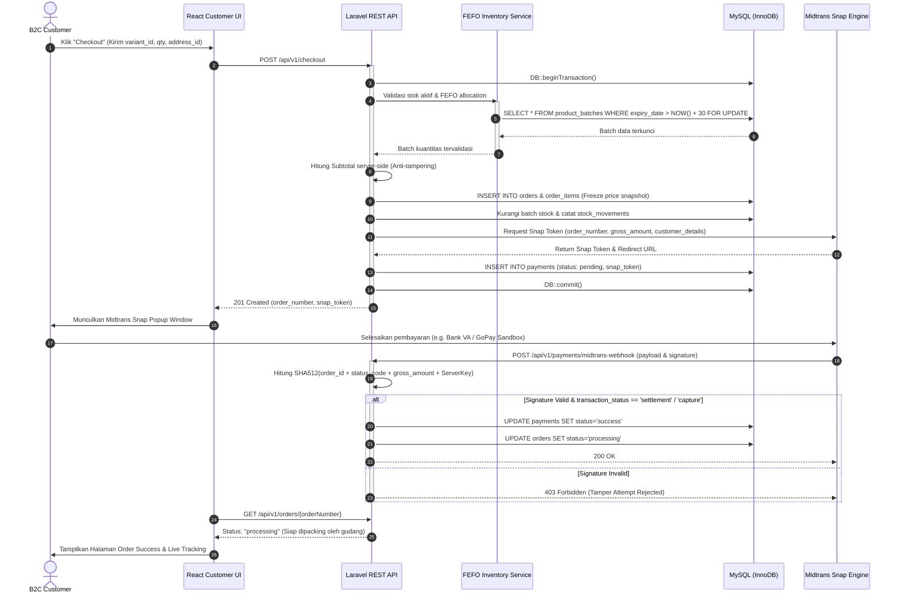
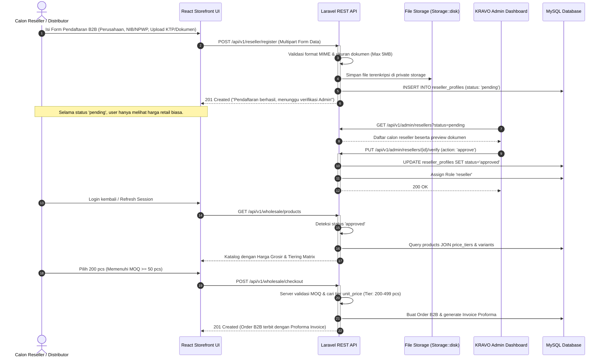
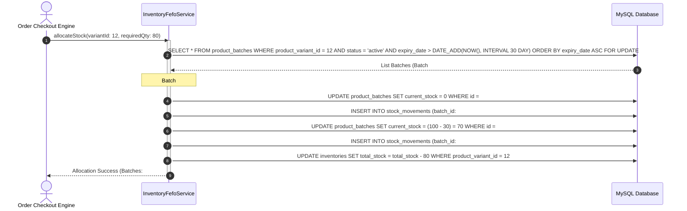

# KRAVO — Architecture & Sequence Diagrams (Tahap 1)

Koleksi diagram arsitektur dan alur sekuensial sistem KRAVO E-Commerce.

---

## 1. Sequence Diagram: B2C Customer Purchase & Midtrans Webhook

---

## 2. Sequence Diagram: B2B Reseller Registration, Verification & Wholesale Order

---

## 3. Sequence Diagram: FEFO (First Expired, First Out) Inventory Allocation

